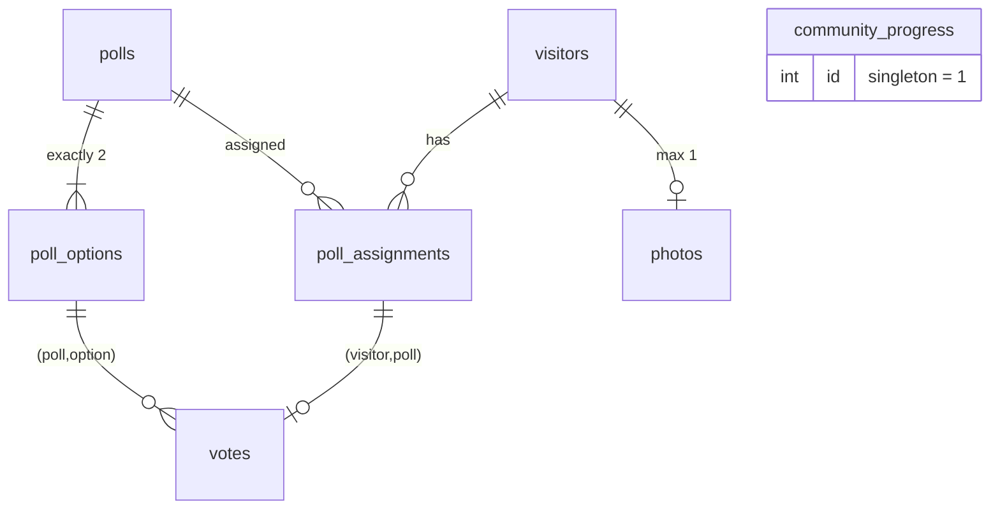

# Checkpoint CCXP26 — Backend

ASP.NET Core (.NET 10) + PostgreSQL + NetVips/libvips (AVIF). The frontend in the separate [`checkpoint-ccxp26-frontend`](https://github.com/atilaalcantara/checkpoint-ccxp26-frontend) repository consumes this API. Its HTTP contract is documented in that repository's `CONTRATO_API.md`.

## Layout

```text
src/Checkpoint.Api/
  Program.cs              routes, error middleware, CORS, startup (migrate / seed / codec probe)
  ParticipationService.cs participation, vote and photo (one transaction per confirmed event)
  ResultsService.cs       authorized, complete live results ordered by title
  ImageProcessor.cs       format detection, limits, orientation, 360x330 AVIF thumbnail
  Progression.cs          level definitions, configurable thresholds, private artwork catalog
  Persistence.cs          SQL migration (EF Core history table) + data access helpers
  DemoSeed.cs             idempotent demo polls (Development only)
  PrivateAssets/          level artwork AVIFs; copied to output, NEVER served statically
tests/Checkpoint.Tests/   13 domain cases + 8 PostgreSQL integration scenarios (+ Fixtures/ with real HEIC/JPEG 2000 and TIFF/GIF/BMP used as refusal cases)
api.http                  request examples
```

EF Core is used only for versioned migrations (history table `checkpoint.__EFMigrationsHistory`); queries are explicit SQL via Npgsql/Dapper so each transaction is visible.

## Entities (schema `checkpoint`)



Integrity enforced by the database: `votes` PK `(visitor_id, poll_id)`; FK to `poll_assignments` (no vote on unassigned poll); composite FK `(poll_id, option_id)` (option belongs to poll); `poll_assignments` unique `(visitor, poll)` and `(visitor, position)` with position 0-2 (max three); `photos.visitor_id` unique; deferred trigger requiring exactly two options per poll. The historical migration also creates unused `idempotency_operations`, `result_snapshots`, and option presentation columns; these remain to preserve existing data and migration history.

XP lives in a single row (`community_progress`), incremented with `UPDATE ... SET total_xp = total_xp + n, revision = revision + 1` inside the same transaction that inserts the vote/photo. There is no separate ledger, so there is one source of truth.

## Consistency and recovery

- Every write takes `pg_advisory_xact_lock(hash(visitorId))`, serializing the same visitor (also before the visitor row exists). Concurrent `PUT /participation`, votes and photos for one visitor cannot interleave.
- After a lost response or duplicate conflict, call `PUT /api/v1/participation`: `answerOptionId` shows the saved vote and `photoStatus` shows whether any photo was saved. The photo status does not identify its file. If an original request is still processing, an immediate read may precede its commit: wait and recheck. A repeat returns `409 ALREADY_VOTED` or `409 PHOTO_ALREADY_SUBMITTED`; locks and database constraints prevent duplicate XP.
- Photo: bytes are validated and encoded *before* the short transaction, under a bounded semaphore (`Images:Concurrency`, default 2; extra requests get `503 PROCESSING_BUSY`). Failure at any point consumes neither the slot nor XP.
- Results: each authorized request returns all visible polls with at least one vote, ordered by title using case-insensitive `pt-BR` collation and ID as the tie-breaker. A single SQL statement gives coherent counts; the in-memory title sort is independent of database collation. The frontend ranks polls by votes. No cursor, pagination, or new persisted snapshot is used; the unused legacy snapshot table and its rows remain untouched. `asOfUtc` is an approximate query-start time, not a monotonic revision.

## Configuration

Provide the connection string through environment variables or user secrets. A safe configuration template without credentials is in `src/Checkpoint.Api/appsettings.example.json`:

```bash
export ConnectionStrings__Checkpoint='Host=127.0.0.1;Port=5432;Database=postgres;Username=dev;Password=<dev password>'
# or: dotnet user-secrets set "ConnectionStrings:Checkpoint" "..." --project src/Checkpoint.Api
```

| Variable | Default | Meaning |
|---|---|---|
| `Database__MigrateOnStartup` | `false` | apply migrations at start |
| `Database__SeedDemo` | `false` | demo polls; refuses to run outside Development |
| `Cors__Origins__0..n` | Astro localhost:4321 | used outside Development; explicit origins only (`*` rejected) |
| `Images__MaxFileBytes` / `MaxPixels` / `Concurrency` | 10 MiB / 40 MP / 2 | upload limits |
| `Progression__FriendsAtXp` / `DatingAtXp` / `EngagedAtXp` / `MarriedAtXp` | 3 / 7 / 12 / 19 | cumulative XP required for each level |

### XP level thresholds

`Progression` thresholds default to the values in `appsettings.example.json`. The first level starts at 0; level names and private artwork are defined in `Progression.cs`. Thresholds must be integers satisfying `0 < FriendsAtXp < DatingAtXp < EngagedAtXp < MarriedAtXp`; invalid values prevent startup. For Docker deployment, environment variables such as `Progression__MarriedAtXp=230` override the defaults without rebuilding the image. Restart the API after changing its settings.

The database stores the current community XP, not the thresholds. Changing thresholds does not reset XP; it recalculates the current level from the same XP and **does not increment `revision`**. Configure them before the event and refresh `GET /api/v1/progress` after a configuration change; a frontend relying only on the XP revision cannot detect it. If the configuration is baked into the image instead of supplied through environment or a mounted file, rebuild the image to change it.

## Run on the Mac

```bash
cd Backend
export ConnectionStrings__Checkpoint='...'
ASPNETCORE_ENVIRONMENT=Development Database__MigrateOnStartup=true Database__SeedDemo=true \
  dotnet run --project src/Checkpoint.Api --urls http://127.0.0.1:5080
```

Migrations only (no server): `dotnet run --project src/Checkpoint.Api -- --migrate-only`. Migrations create only schema `checkpoint`; the `Down` is deliberately unsupported so nothing can drop it automatically.

In Development, browse **`/swagger`** for interactive Swagger UI or fetch the generated OpenAPI document at `/openapi/v1.json`. Supply a UUID v4 `X-Visitor-Id` to personalized operations. For example, with the Mac command above use `http://127.0.0.1:5080/swagger`; with the Docker port mapping below use `http://127.0.0.1:8080/swagger`. The UI and document are unavailable in Production. OpenAPI schemas derive from C# response models and route metadata; when changing an endpoint, update its response metadata and descriptions alongside its implementation. Runtime visitor-facing error messages and poll content remain in Portuguese.

## Run in Ubuntu ARM64 container (Docker Desktop on the Mac)

```bash
# image installs Ubuntu libvips + libheif/libde265 (HEIC support)
docker build --platform linux/arm64 --target final -t checkpoint-api:local .
docker run -d --name checkpoint-api-run --platform linux/arm64 -p 127.0.0.1:8080:8080 \
  -e ASPNETCORE_ENVIRONMENT=Development \
  -e ConnectionStrings__Checkpoint='Host=host.docker.internal;Port=5432;Database=postgres;Username=dev;Password=<dev password>' \
  checkpoint-api:local
```

`host.docker.internal` works only on Docker Desktop. On a real Ubuntu ARM host set the real database host; do not publish PostgreSQL on all interfaces. Run migrations with the same image and `--migrate-only`.

### CORS

`Development` allows any origin, without browser credentials. Other environments use the explicit `Cors:Origins` list, never `*`; set the deployed frontend's exact origin (scheme, host, and port if applicable). Configuration providers merge arrays by index: `appsettings.json` currently defines two localhost entries, so overriding only `Cors__Origins__0` leaves `Cors__Origins__1` in place. For production, replace or override **all** configured entries with the intended origin(s). Allowed methods: GET, PUT, POST; allowed request headers: `Content-Type`, `X-Visitor-Id`. The response header `Retry-After` is exposed to cross-origin JavaScript, including on error responses.

## Tests

Integration tests use real PostgreSQL and create a throw-away database `checkpoint_test_<random>` (dropped in teardown, including startup failure). They never touch the development schema. `CHECKPOINT_TEST_ADMIN` must be a connection string with CREATEDB rights:

```bash
CHECKPOINT_TEST_ADMIN='Host=127.0.0.1;Database=postgres;Username=dev;Password=...' dotnet test
# in Ubuntu ARM64:
docker build --platform linux/arm64 --target test -t checkpoint-tests:local .
docker run --rm --platform linux/arm64 -e CHECKPOINT_TEST_ADMIN='Host=host.docker.internal;...' checkpoint-tests:local
```

If a run is killed, clean leftovers with `DROP DATABASE "checkpoint_test_..."` (only those names).

## Image policy

Accepted input is deliberately limited to the common photo formats and converted to a 360x330 AVIF thumbnail (centre `cover`, Q60, metadata stripped, orientation applied, embedded ICC profile converted to sRGB, transparency flattened onto white). The format is identified by libvips from the file content, never from the name or declared MIME.

| Format | Notes |
|---|---|
| JPEG, PNG, WebP, AVIF | always |
| **HEIC/HEIF (iPhone)** | needs HEVC decoding: Linux image only (see below). Verified with real 3840x2160 and 4592x3448 files |
| **JPEG 2000** | needs OpenJPEG: Linux image only; the NuGet libvips used on the Mac cannot read it |

Everything else is refused with `415 UNSUPPORTED_IMAGE_FORMAT`, including GIF, TIFF, BMP, PSD, ICO, SVG and PDF, even when libvips could read them. ImageMagick is therefore never reached. Corrupt or truncated files of an accepted format give `422`. Files over 10 MiB give `413`; more than 40 MP gives `422 IMAGE_DIMENSIONS_EXCEEDED`. Animated WebP and multi-image HEIC use only the first frame.

**HEIC and the bundled libvips.** The `NetVips.Native` package (libvips 8.18.7) reads HEIC headers but cannot decode HEVC pixels, so it fails. The container build therefore sets `UseSystemVips=true`, drops that package and installs Ubuntu `libvips42t64` (8.15.1) with `libheif-plugin-libde265`. At startup the API decodes an embedded 5.8 KB HEIC; the result is logged (`HEIC (HEVC) decoding True/False`). Where it is False (for example `dotnet run` on the Mac) HEIC uploads return a clear `415` and everything else still works. To get HEIC on the Mac, install `brew install vips` and make it resolvable to NetVips; this was not attempted. The libde265/HEVC codec is LGPL but HEVC itself carries patent-licensing considerations: check them for your deployment.

## Limitations and decisions for the product owner

- Original upload is stored in PostgreSQL (`bytea`) as per the contract; no retention/removal policy or moderation yet. New photos are public immediately.
- `X-Visitor-Id` is an anonymous, forgeable identifier; limits are per browser identifier only. Image processing is concurrency-limited; add a reverse-proxy rate limit before the event.
- Results require at least one vote from any visitor; this is the provisional contract rule.
- The API returns only the current and unlocked artwork. The frontend build omits future artwork, but artwork in a public source repository can still be discovered; treat it as a visual spoiler, not a secret.
- Frontend integration includes visitor UUID persistence, write reconciliation, live results/progress and photo upload. Periodic results refresh defaults to 30 seconds and is not a production load guarantee; measure response size and load before the event.
- Production needs HTTPS termination, an explicit CORS origin, a non-demo poll set and migration execution as a deploy step.
